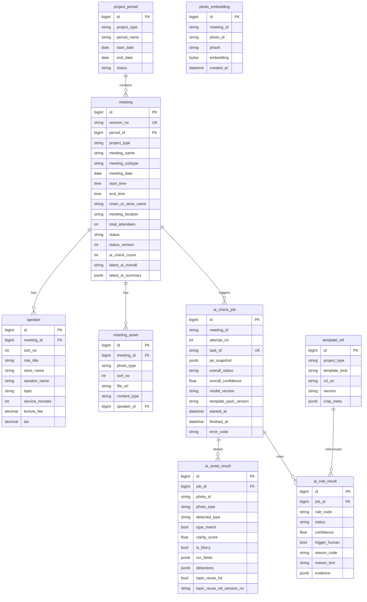

# ER 与字段字典

命名约定：`snake_case`；主键 `BIGINT`（可改为 UUID）；时间字段 `*_at`；枚举存字符串码。

业务库（PE）与 AI 审核结果库逻辑分离：会议主数据在 PE；每次审核快照与逐条规则结果落 AI 侧表，便于追溯与重跑。

AI API 字段对齐 CRM：`photos[]` / `photo_id` / `photo_type` / `file_url` / `lecture_fee`；讲者照用 `SpeakerTitle` / `SpeakerLecture`（无 `speaker_shot_kind`）。详见 [CRM与AI-API字段对照.md](CRM与AI-API字段对照.md)。

## ER 图



## 表字段说明

### project_period（项目期数）

| 字段 | 类型 | 必填 | 说明 |
|------|------|------|------|
| id | BIGINT PK | Y | 主键 |
| project_type | VARCHAR(32) | Y | `LECTURE_HALL` \| `MICRO` |
| period_name | VARCHAR(100) | Y | 如「药师大讲堂一期」 |
| start_date | DATE | Y | 期数开始 |
| end_date | DATE | Y | 期数结束 |
| status | VARCHAR(16) | Y | `ACTIVE` \| `CLOSED` |
| created_at / updated_at | TIMESTAMPTZ | Y | 审计时间 |

### meeting（会议执行记录）

| 字段 | 类型 | 必填 | 说明 |
|------|------|------|------|
| id | BIGINT PK | Y | 主键 |
| session_no | VARCHAR(20) | Y | 场次编号，全局唯一 |
| period_id | BIGINT FK | Y | 关联期数 |
| project_type | VARCHAR(32) | Y | 冗余便于查询分流 |
| meeting_name | VARCHAR(50) | Y | 会议名称 |
| meeting_subtype | VARCHAR(16) | N | 微型：`SINGLE` \| `DUAL`；大讲堂 NULL |
| meeting_date | DATE | Y | 会议日期 |
| start_time | TIME | Y | 开始时间 |
| end_time | TIME | Y | 结束时间 |
| chain_or_store_name | VARCHAR(50) | Y | 大讲堂=连锁名称；微型=药店名称 |
| meeting_location | VARCHAR(200) | Y | 会议地点（与海报 OCR 地点比对；API `form.meeting_location`） |
| remark | VARCHAR(200) | N | 备注 |
| total_attendees | INT | Y | 总参会人数 |
| other_fee | DECIMAL(12,2) | N | 其他费用 |
| status | VARCHAR(16) | Y | 见枚举 `meeting.status` |
| status_version | INT | Y | 乐观锁，默认 0；写回/人工改状态时 +1 |
| ai_check_count | INT | Y | AI 校验次数，默认 0 |
| latest_ai_overall | VARCHAR(16) | N | 最近一次 `PASS`/`FAIL`/`NEED_HUMAN` |
| latest_ai_summary | JSONB | N | 展示用摘要（matched/failed） |
| latest_job_id | BIGINT | N | 最近一次 ai_check_job.id |
| created_at / updated_at | TIMESTAMPTZ | Y | |

### speaker（讲者）

| 字段 | 类型 | 必填 | 说明 |
|------|------|------|------|
| id | BIGINT PK | Y | |
| meeting_id | BIGINT FK | Y | |
| sort_no | INT | Y | 展示顺序，从 1 起 |
| role_title | VARCHAR(10) | Y | 身份 |
| store_name | VARCHAR(50) | Y | 所属门店 |
| speaker_name | VARCHAR(20) | Y | 姓名 |
| topic | VARCHAR(50) | Y | 讲者主题 |
| service_minutes | INT | Y | 服务时长（分钟） |
| lecture_fee | DECIMAL(12,2) | Y | 讲课费（API `lecture_fee`） |
| tax | DECIMAL(12,2) | N | 税金，最多 2 位小数 |

### meeting_asset（会议材料 / 对齐 CRM Photo）

| 字段 | 类型 | 必填 | 说明 |
|------|------|------|------|
| id | BIGINT PK | Y | 业务侧主键；对外 API 用字符串 `photo_id` |
| meeting_id | BIGINT FK | Y | |
| photo_type | VARCHAR(32) | Y | 见 `photo_type` 枚举（与 CRM `PhotoType` 同值） |
| sort_no | INT | Y | 同类型多张时的顺序 |
| file_url | VARCHAR(512) | Y | 如 `s3://bucket/key`（API `file_url`） |
| content_type | VARCHAR(64) | Y | `image/jpeg` / `image/png` / `application/pdf` |
| file_size_bytes | BIGINT | N | 可选 |
| speaker_id | BIGINT FK | N | `SpeakerTitle` / `SpeakerLecture` 必填 |
| created_at | TIMESTAMPTZ | Y | |

> 讲者合影与讲课照用不同 `photo_type`（`SpeakerTitle` / `SpeakerLecture`），不再使用 `speaker_shot_kind`。

### ai_check_job（一次材料检查任务）

| 字段 | 类型 | 必填 | 说明 |
|------|------|------|------|
| id | BIGINT PK | Y | |
| meeting_id | VARCHAR(36) | Y | 对齐 CRM MeetingID / API string |
| attempt_no | INT | Y | 本场第几次审核（与 pe 的 ai_check_count 对齐） |
| task_id | VARCHAR(50) UK | Y | 幂等键；对齐 CRM TaskID / API `task_id`；重复请求不重复计次 |
| pe_snapshot | JSONB | Y | 调用时表单+照片快照 |
| overall_status | VARCHAR(16) | N | `PASS`/`FAIL`/`NEED_HUMAN`/`ERROR` |
| overall_confidence | REAL | N | 0~1 |
| model_version | VARCHAR(64) | N | 模型/流水线版本 |
| template_pack_version | VARCHAR(32) | N | 模版包版本 |
| started_at | TIMESTAMPTZ | Y | |
| finished_at | TIMESTAMPTZ | N | |
| error_code | VARCHAR(64) | N | 系统错误码（非业务 FAIL） |
| error_message | TEXT | N | |

### ai_asset_result（单张材料分析结果；API 响应字段为 `photo_results[]`）

| 字段 | 类型 | 必填 | 说明 |
|------|------|------|------|
| id | BIGINT PK | Y | |
| job_id | BIGINT FK | Y | |
| photo_id | VARCHAR(36) | Y | 对齐 CRM PhotoID / 请求 `photos[].photo_id` |
| photo_type | VARCHAR(32) | N | PE 声明类型（响应 `photo_type`） |
| detected_type | VARCHAR(32) | N | 模型判定的类别（full） |
| type_match | BOOLEAN | N | 是否与声明 `photo_type` 一致 |
| clarity_score | REAL | N | 0~1 |
| is_blurry | BOOLEAN | N | clarity < 阈值 |
| ocr_fields | JSONB | N | 抽取字段，见下方结构 |
| detections | JSONB | N | 检测框/物体（台卡 ROI、Logo、人数等） |
| topic_reuse_hit | BOOLEAN | N | 讲者照标题是否命中历史 |
| topic_reuse_ref_session_no | VARCHAR(20) | N | 命中的历史场次编号 |
| topic_text_ocr | TEXT | N | 讲者照 OCR 标题 |

**ocr_fields 建议结构：**

```json
{
  "meeting_date": "2026-04-17",
  "meeting_time": "14:00",
  "location": "信阳市六合春宴酒店（信阳师范大学店）",
  "speaker_names": ["高芳", "袁芳", "刘亭", "余艳红"],
  "topics": ["..."],
  "duration_minutes": 130,
  "watermark": {
    "datetime": "2026-05-27T14:35:00",
    "place_text": "合肥市·老百姓大药房..."
  },
  "raw_text_preview": "..."
}
```

### ai_rule_result（单条规则结果）

| 字段 | 类型 | 必填 | 说明 |
|------|------|------|------|
| id | BIGINT PK | Y | |
| job_id | BIGINT FK | Y | |
| rule_code | VARCHAR(64) | Y | 见规则枚举 |
| status | VARCHAR(16) | Y | `PASS`/`FAIL`/`SKIP`/`UNCERTAIN` |
| confidence | REAL | N | 0~1 |
| trigger_human | BOOLEAN | Y | 是否建议人工 |
| reason_code | VARCHAR(64) | N | 机器可读原因码 |
| reason_text | TEXT | N | 中文说明 |
| evidence | JSONB | N | crop、期望值、OCR 原文等 |
| related_photo_ids | VARCHAR(36)[] | N | 可选；对齐响应 `related_photo_ids` |

### template_ref（模版参考图）

| 字段 | 类型 | 必填 | 说明 |
|------|------|------|------|
| id | BIGINT PK | Y | |
| project_type | VARCHAR(32) | Y | |
| template_kind | VARCHAR(32) | Y | 见 `template_kind` |
| period_id | BIGINT FK | N | 可绑定期数；空=通用 |
| s3_uri | VARCHAR(512) | Y | crop 或整图（模版 pack 内部路径键，非请求 `file_url`） |
| version | VARCHAR(32) | Y | 与 template_pack_version 对齐 |
| crop_meta | JSONB | N | `{x,y,w,h,source_asset,note}` |
| is_active | BOOLEAN | Y | 默认 true |

### photo_embedding / image_dup_history（查重索引）

| 字段 | 类型 | 必填 | 说明 |
|------|------|------|------|
| id | BIGINT PK | Y | |
| meeting_id | VARCHAR(36) | Y | |
| photo_id | VARCHAR(36) | Y | |
| photo_type | VARCHAR(32) | N | |
| period_id | VARCHAR(36) | N | 便于按期检索 |
| phash | VARCHAR(64) | N | 感知哈希 |
| embedding | BYTEA / VECTOR | N | 向量（若用 pgvector） |
| created_at | TIMESTAMPTZ | Y | |

---

## 枚举字典

### meeting.status

| 码 | 含义 |
|----|------|
| DRAFT | 导入未齐图 |
| PENDING | 待校验（已推 AI） |
| PASS | 通过 |
| FAIL | 不通过 |
| NEED_HUMAN | 待人工 |
| CLOSED | 关闭（可选） |

### project_type

| 码 | 含义 |
|----|------|
| LECTURE_HALL | 药师大讲堂 |
| MICRO | 微型药师 |

### meeting_type

| 码 | 适用 | 含义 |
|----|------|------|
| SINGLE | MICRO | 单讲者 |
| DUAL | MICRO | 双讲者 |
| （null） | LECTURE_HALL | 大讲堂不传 |

### photo_type（与 CRM `PhotoType` / API 同值）

#### 药师大讲堂（LECTURE_HALL）

| 码 | 中文 | 数量要求 |
|----|------|----------|
| EDM | 电子日程海报 | ≥1 |
| Poster | 日程海报 | ≥1 |
| Stand | 日程展架 | ≥1 |
| TableCard | 台卡 | ≥1 |
| Manual | 手册 | ≥1 |
| SpeakerTitle | 讲者标题合影 | 每讲者 ≥1（须 `speaker_id`） |
| SpeakerLecture | 讲者讲课照 | 每讲者 ≥1（须 `speaker_id`） |
| Panorama | 参会人员全景 | ≥1 |
| SignSheet | 签到表 | ≥1（jpg/png/pdf） |

#### 微型药师（MICRO）

| 码 | 中文 | 数量要求 |
|----|------|----------|
| EDM | 电子日程海报 | ≥1 |
| EDMDisplay | 电子日程海报展示 | ≥1 |
| ProjectIntro | 项目介绍展示 | ≥1 |
| SpeakerTitle | 讲者标题合影 | 单 1 / 双 2（须 `speaker_id`） |
| Panorama | 参会人员全景 | ≥1 |
| SignSheet | 签到表 | ≥1 |

### template_kind

| 码 | 含义 |
|----|------|
| Poster | 日程海报版式 |
| Stand | 展架版式 |
| TableCard | 台卡底纹 |
| Manual | 手册封面 |
| PPT_INTRO | 项目介绍 PPT 页 |
| PPT_AGENDA | 电子日程 PPT 页 |
| SignSheet | 签到表标准模版 |
| LOGO_BAYER | 拜耳 Logo 参考 |
| SpeakerTitle | 讲者标题条 crop（评测用） |

### ai_check_job.overall_status / rule status

| 码 | 层级 | 含义 |
|----|------|------|
| PASS | job/rule | 通过 |
| FAIL | job/rule | 不通过 |
| NEED_HUMAN | job | 需人工（由 UNCERTAIN 或策略聚合） |
| UNCERTAIN | rule | 无法可靠判定 |
| SKIP | rule | 本类型不适用 |
| ERROR | job | 系统错误（S3/超时等） |

### rule_code（完整列表）

见 [03-rule-matrix.md](03-rule-matrix.md)。摘要：

| rule_code | 适用 |
|-----------|------|
| ASSET_TYPE_CHECK | 两者 |
| CLARITY | 两者 |
| ASSET_MISSING | 两者 |
| KEY_FIELD_MATCH | 两者 |
| TIME_CONSISTENCY | 两者（海报等日程时间；不做时间水印） |
| BAYER_LOGO | 两者 |
| PANORAMA_COUNT | 两者 |
| SIGNIN_DURATION | 两者 |
| SIGNIN_RATIO_AND_STORES | 微型 |
| IMAGE_DUP | 两者（盗用他场照：pHash/embedding，仅跨会议，不查会内） |
| TOPIC_REUSE | 两者（仅讲者照主题/标题文本） |
| ~~WATERMARK_CONSISTENCY~~ | 已下线（时间/日期/地点水印均不审） |
| NAME_CARD_SPEAKER_MATCH | 大讲堂 |
| HANDBOOK_DETECT | 大讲堂 |
| HANDBOOK_NOT_STALE | 大讲堂 |
| SPEAKER_TOPIC_OCR | 大讲堂 |
| SPEAKER_SHOT_PAIR | 大讲堂 |
| SPEAKER_COMPOSITION | 两者（标题合影四要素；授课照人+PPT） |
| PPT_TEMPLATE_MATCH | 微型 |
| PPT_PAGE_KIND | 微型 |

### reason_code（常用）

| 码 | 说明 |
|----|------|
| BLURRY | 清晰度不足 |
| TYPE_MISMATCH | 照片类别与声明不符 |
| FIELD_MISMATCH | 关键字段与表单不一致 |
| LOGO_MISSING | 未检出拜耳 Logo（微型） |
| SPONSOR_MISSING | 未检出赞助方「拜耳医药保健有限公司」（大讲堂） |
| SPONSOR_UNCERTAIN | 赞助方文案检出灰区 |
| COUNT_BELOW_THRESHOLD | 人数不足 |
| DURATION_BELOW_THRESHOLD | 时长不足 |
| IMAGE_DUP | 与其他会议混用照片（完全一致或近似相似） |
| TOPIC_REUSED | 讲者照主题/标题与历史会议重复 |
| NAME_SET_MISMATCH | 台卡姓名集合不匹配 |
| HANDBOOK_NOT_FOUND | 未识别到规定手册 |
| HANDBOOK_STALE | 疑似旧版手册 |
| TEMPLATE_MISMATCH | 模版不一致 |
| TOPIC_MISMATCH | 课件标题与主题不一致 |
| S3_NOT_FOUND | 对象不存在 |
| S3_TIMEOUT | 拉取超时 |
| OCR_LOW_CONFIDENCE | OCR 置信度低 |

---

## 索引建议

- `meeting(session_no)` UNIQUE
- `meeting(period_id, status)`
- `meeting(project_type, meeting_date)`
- `speaker(meeting_id)`
- `meeting_asset(meeting_id, photo_type)`
- `ai_check_job(task_id)` UNIQUE
- `ai_check_job(meeting_id, attempt_no)`
- `ai_rule_result(job_id, rule_code)`
- `photo_embedding(period_id)` + phash / vector 索引
